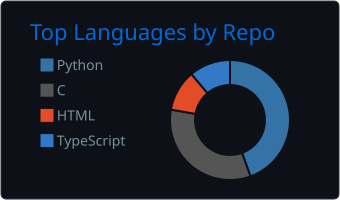
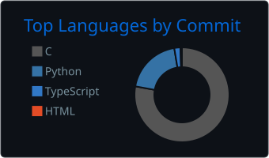

<h1 align="center">Hello there, this is Huraira</h1>

###

<h5 align="center">
A coding samurai, wielding logic and creativity to slash through bugs and build flawless software!!
</h5>

  

  
  
  

###

 

###

<b>Studying:</b> B.Sc. in CSE @ University of Liberal Arts Bangladesh (ULAB), expected 2029 
<b>Interests:</b> Software Architecture, System Design, AI Governance, AI-Assisted Development 
<b>Domains:</b> Biology, Philosophy, Religion, Fiction 
<b>Contact:</b> <a href="mailto:hurairiam@gmail.com">hurairiam@gmail.com</a>

 

 

  

  
  

Updated automatically every day from my GitHub activity.

 

  

| Project | What it is | Stack |
|---|---|---|
| [**Compile & Conquer**](https://github.com/Hurairiam/cse-life-compile-and-conquer) | A life-simulation RPG about surviving CSE. I led the team and owned the core OOP architecture across 5 Agile sprints, with persistent save/load, a custom UI and an in-house level editor. | `Python` `Pygame` `JSON` `Git` |
| [**SemesterView**](https://github.com/Hurairiam/SemesterView) | A unified academic assistant for ULAB students: schedules, exams, room availability, faculty info and research opportunities. Built with a 3-person team inside a 3-hour hackathon window. | `TypeScript` `Replit Agent` `Prompt Engineering` |
| [**Flood Risk Analytics**](https://github.com/Hurairiam/flood-risk-analytics) | Statistical and probabilistic analysis of river water-level data from 127 flood-monitoring stations across Bangladesh, built on real FFWC/BWDB bulletins. | `Python` `Statistics` `Probability` |

 

  

  
  
  
  
  
  
  
  
  
  
  
  
  
  
  
  
  
  
  
  
  

###

| Area | Skills |
|---|---|
| **Languages** | C, C++, Java, Python, TypeScript |
| **Software Engineering** | OOP, Software Architecture, System Design, Requirements Engineering, UML, SDLC, Agile |
| **Development Stack** | Pygame, Java Swing, JDBC, JSON, SQLite |
| **Governance & Compliance** | AI Governance, Privacy Management, ISO/IEC 42001, ISO/IEC 27701 |
| **AI Productivity Tools** | Claude, NotebookLM, Google AI Studio, Replit Agent |

 

  

| Hackathon | What we built | Repo |
|---|---|---|
| **ULAB UCPC Hackathon, Club Week Challenge 2026** 1st Place · 15 Aug 2026 | **SemesterView**: a unified academic assistant for ULAB students (personal timetable, free-room finder, exams, faculty and research matching), built in a 3-hour sprint with team *The Special One*. | [SemesterView](https://github.com/Hurairiam/SemesterView) |
| **BUP CSE Fest 2026, GridWise Track** Prelims | **Cogitator-Optimus**: a FastAPI backend that turns plain-English operator notes into a minimum-cost 24-hour campus energy schedule, using an LLM to read the notes, Pydantic to validate them and PuLP linear programming to solve the plan. | [BUP_hackathon_prelims](https://github.com/Hurairiam/BUP_hackathon_prelims) |
| **ULAB CSE Fest 2025 Hackathon** Top 9 Finalist · 24 Jul 2025 | **Sync4U**: a campus connectivity app prototype (schedule matching, vacant-room finder, clubs, chat) built with Lovable and ChatGPT by team *Bamboo Warriors*. Our first hackathon. | [Our-First-Hackathon](https://github.com/Hurairiam/Our-First-Hackathon) |

 

  

<b>Governance &amp; Compliance (2026)</b> &nbsp;⬇️

 

- Completed: [ISO/IEC 42001:2023 Lead Auditor](https://learn.mastermindassurance.com/certificates/najobjza7c) — Artificial Intelligence Management Systems — Mastermind
- Completed: [ISO/IEC 27701:2025 Lead Auditor](https://learn.mastermindassurance.com/certificates/sc8sph94j3) — Privacy Information Management Systems — Mastermind

<b>Cybersecurity &amp; Marketing (2026)</b> &nbsp;⬇️

 

- Completed: [Fortinet Certified Fundamentals in Cybersecurity](https://github.com/Hurairiam/certifications/blob/main/Fortinet%20Certified%20Fundamentals%20in%20Cybersecurity/readme.md) — [Certificate](https://github.com/Hurairiam/certifications/blob/main/Fortinet%20Certified%20Fundamentals%20in%20Cybersecurity/Fortinet%20Certified%20Fundamentals%20in%20Cybersecurity.pdf)
- Completed: [AEO Fundamentals by HubSpot Academy](https://app-na2.hubspot.com/academy/achievements/v7hxxm1f/en/1/abu-huraira/aeo-fundamentals)

<b>AI, Prompting &amp; Agile (IBM / Google)</b> &nbsp;⬇️

 

- Completed: [Explore Emerging Tech by IBM](https://github.com/Hurairiam/certifications/blob/main/Explore%20Emerging%20Tech%20by%20IBM/README.md) — [Certificate](https://github.com/Hurairiam/certifications/blob/main/Explore%20Emerging%20Tech%20by%20IBM/Explore%20Emerging%20Tech%20Certificate.pdf)
- Completed: [Artificial Intelligence Fundamentals by IBM](https://github.com/Hurairiam/certifications/blob/main/Artificial%20Intelligence%20Fundamentals%20by%20IBM/README.md) — [Certificate](https://github.com/Hurairiam/certifications/blob/main/Artificial%20Intelligence%20Fundamentals%20by%20IBM/Artificial%20Intelligence%20Fundamentals%20Certificate.pdf)
- Completed: [AI Literacy by IBM](https://github.com/Hurairiam/certifications/blob/main/AI%20Literacy%20by%20IBM/README.md) — [Certificate](https://github.com/Hurairiam/certifications/blob/main/AI%20Literacy%20by%20IBM/Ai%20Literact%20Certificate.pdf)
- Completed: [Introduction to Generative AI by IBM & Google](https://github.com/Hurairiam/certifications/blob/main/Introduction%20to%20Generative%20AI%20by%20Google%20and%20IBM/README.md) — [IBM Certificate](https://github.com/Hurairiam/certifications/blob/main/Introduction%20to%20Generative%20AI%20by%20Google%20and%20IBM/Introduction%20to%20Generative%20AI%20by%20Google.pdf) | [Google Badge](https://github.com/Hurairiam/certifications/blob/main/Introduction%20to%20Generative%20AI%20by%20Google%20and%20IBM/Introduction%20to%20Generative%20AI%20By%20Google.png)
- Completed: [Mastering the Art of Prompting by IBM](https://github.com/Hurairiam/certifications/blob/main/Mastering%20the%20Art%20of%20Prompting%20by%20IBM/README.md) — [Certificate](https://github.com/Hurairiam/certifications/blob/main/Mastering%20the%20Art%20of%20Prompting%20by%20IBM/Mastering%20the%20Art%20of%20Prompting%20Certificate.pdf)
- Completed: [Crafting Precision Prompts with Generative AI by IBM](https://github.com/Hurairiam/certifications/blob/main/Crafting%20Precision%20Prompts%20with%20Generative%20AI%20by%20IBM/README.md) — [Certificate](https://github.com/Hurairiam/certifications/blob/main/Crafting%20Precision%20Prompts%20with%20Generative%20AI%20by%20IBM/Crafting%20Precision%20Prompts%20Certificate.pdf)
- Completed: [Everyday Ethics for Artificial Intelligence by IBM](https://github.com/Hurairiam/certifications/blob/main/Everyday%20Ethics%20for%20Artificial%20Intelligence%20by%20IBM/README.md) — [Certificate](https://github.com/Hurairiam/certifications/blob/main/Everyday%20Ethics%20for%20Artificial%20Intelligence%20by%20IBM/Everyday%20Ethics%20for%20Artificial%20Intelligence%20Certificate.pdf)
- Completed: [Agile Explorer by IBM](https://github.com/Hurairiam/certifications/blob/main/Agile%20Explorer%20by%20IBM/README.md) — [Certificate](https://github.com/Hurairiam/certifications/blob/main/Agile%20Explorer%20by%20IBM/Agile%20Explorer%20Certificate.pdf)
- Completed: [Enterprise Design Thinking Practitioner by IBM](https://github.com/Hurairiam/certifications/blob/main/Enterprise%20Design%20Thinking%20Practitioner%20by%20IBM/README.md) — [Certificate](https://github.com/Hurairiam/certifications/blob/main/Enterprise%20Design%20Thinking%20Practitioner%20by%20IBM/Enterprise%20Design%20Thinking%20Practitioner%20Certificate.pdf)

<b>Creative &amp; Coding Bootcamps</b> &nbsp;⬇️

 

- Completed: [Introduction to 2D Animation by Grameenphone Academy](https://github.com/Hurairiam/certifications/blob/main/Introduction%20to%202D%20Animation%20by%20Grameenphone%20Academy/README.md) — [Certificate](https://github.com/Hurairiam/certifications/blob/main/Introduction%20to%202D%20Animation%20by%20Grameenphone%20Academy/Introduction%20to%202D%20Animation.pdf) | [Projects](https://github.com/Hurairiam/certifications/tree/main/Introduction%20to%202D%20Animation%20by%20Grameenphone%20Academy/Projects)
- Completed: [CoderHunt 3.0 Bootcamp by Shohoj Coding](https://github.com/Hurairiam/certifications/blob/main/CoderHunt%203.0%20Bootcamp%20by%20Shohoj%20Coding/README.md) — [Certificate](https://github.com/Hurairiam/certifications/blob/main/CoderHunt%203.0%20Bootcamp%20by%20Shohoj%20Coding/CoderHunt-3.0-Certificate.pdf)

 

  

  
  
  
  
  
  
  
  
  

  

Even a samurai needs good documentation.

